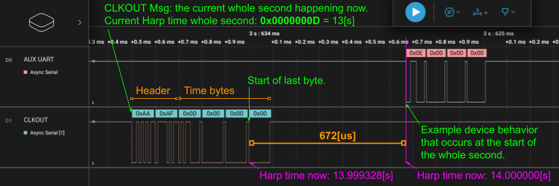

# Harp Time Code

This document provides the specification for the Harp Time Code, a serial signal carrying the current Harp time in whole seconds, to be recorded by non-Harp acquisition systems alongside data acquired using their own local clock. The recorded data can then be aligned with the Harp time base, correcting for offset and drift, during post-hoc analysis. Including the whole second in each transmission allows the Harp time to be recovered even when recordings start at different times or individual transmissions are lost. The Harp Time Code is not a synchronization protocol, and Harp devices synchronize their clocks only through the [Harp Synchronization Clock](SynchronizationClock.md).

## Requirements Language

The key words "MUST", "MUST NOT", "REQUIRED", "SHALL", "SHALL NOT", "SHOULD", "SHOULD NOT", "RECOMMENDED",  "MAY", and "OPTIONAL" in this document are to be interpreted as described in [RFC 2119](https://www.ietf.org/rfc/rfc2119.txt).

## Wire Protocol

The Harp Time Code is an asynchronous serial signal on a digital output. Its implementation by Harp devices is OPTIONAL. Its configuration, such as enabling the output or selecting the baud rate, SHOULD be provided through device-specific registers following the [Device Interface](Device.md#device-interface), and this specification assigns no core register.

The output MUST remain HIGH when idle. Each byte MUST be transmitted using one LOW start bit, eight data bits, no parity bit, and one HIGH stop bit (8N1). Data bits within each byte MUST be transmitted least significant bit first.

### Transmission Packet (4 bytes)

The Harp Time Code is transmitted in packets. Each transmission packet MUST encode a whole second of the Harp time as a Little-Endian unsigned 32-bit integer (`U32`), corresponding to [`R_TIMESTAMP_SECOND`](Device.md#r_timestamp_second-u32--system-timestamp-seconds), with the structure below:

| Byte                 | 0        | 1         | 2          | 3          |
| -------------------- | -------- | --------- | ---------- | ---------- |
| Whole Second (`U32`) | Bits 0–7 | Bits 8–15 | Bits 16–23 | Bits 24–31 |

The four bytes MUST be transmitted consecutively, with the start bit of each subsequent byte immediately following the stop bit of the preceding byte. No header, fractional timestamp, or checksum is transmitted.

### Baud Rate

The baud rate of the Harp Time Code MAY be fixed or configurable. A configurable baud rate MAY be exposed as a `U32` register whose value is the number of bits transmitted per second. The active baud rate MUST be documented or readable from a register included in the [register dump](Device.md#r_operation_ctrl-u8--operation-mode-configuration). The selected rate MUST allow the complete transmission packet to finish before the next whole second, leaving an idle HIGH interval between packets.

The baud rate SHOULD be selected according to the sampling rate of the recording device. Lower baud rates allow the signal to be recorded by systems with lower sampling rates, but increase the duration of each transmission. The recording device SHOULD acquire multiple samples per bit to allow reliable decoding.

For example, at 1 kbps, each bit lasts 1 ms, and the four-byte packet occupies 40 ms, since each byte takes ten bits including its start and stop bits.

### Transmission Timing

While the Harp Time Code output is enabled, the Device MUST transmit one packet at the start of each whole second of its Harp clock. The first falling edge, from the idle HIGH level to the LOW start bit of the first byte, MUST mark the start of the whole second encoded in that packet, and the Device MUST capture that value at this boundary and use it for all four bytes. This differs from the Harp Synchronization Clock, whose reference edge comes 672 μs before the encoded second ends.

The timing error between the first falling edge and the whole-second boundary SHOULD be less than 32 μs, and SHOULD be validated at the physical output, including the effects of interrupt latency and serial peripheral scheduling.

The Harp Time Code output MUST NOT interfere with the timing or operation of the Harp Synchronization Clock when both outputs are enabled.

### Example Logic Trace

The upper **AUX UART** trace below illustrates the Harp Time Code, sent at a baud rate close to that of the synchronization clock so that both signals are visible on the same time scale, although it is normally sent at a much lower baud rate. The output is initially HIGH, and the first falling edge marks the start of Harp second `14`. The packet carries no header, only the four bytes `0x0E`, `0x00`, `0x00`, and `0x00`, which encode the whole second as a Little-Endian `U32`. After the final stop bit, the output remains HIGH until the next packet.

The lower **CLKOUT** trace shows the [Harp Synchronization Clock](SynchronizationClock.md) for comparison.

## Documentation

A Device implementing the Harp Time Code MUST document:

- the output connector, pin assignment and logic levels, since serial framing alone does not imply RS-232 voltage levels or the physical connector of the Harp Synchronization Clock;
- the baud rate, or the supported values and the default value if the baud rate is configurable;
- the maximum timing error of the output, measured as described in [Transmission Timing](#transmission-timing);
- the address, supported values and access of any configuration registers.
