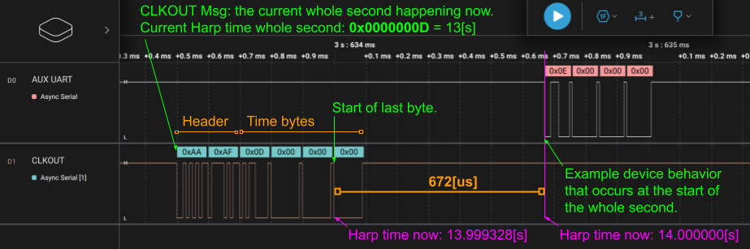

# Timestamp Broadcasting

This document proposes a serial communication protocol for broadcasting the current Harp time to non-Harp devices. The signal can be recorded alongside data acquired using a local clock, allowing the recorded data to be aligned with the Harp time base during post-hoc analysis. This strategy effectively enables interoperability between devices in- and out-of-the-Harp ecosystem.

## Requirements Language

The key words "MUST", "MUST NOT", "REQUIRED", "SHALL", "SHALL NOT", "SHOULD", "SHOULD NOT", "RECOMMENDED",  "MAY", and "OPTIONAL" in this document are to be interpreted as described in [RFC 2119](https://www.ietf.org/rfc/rfc2119.txt).

## Motivation

Non-Harp acquisition systems often record data using independent local clocks. Recording a digital signal carrying the Harp time provides a common reference for aligning these recordings with data acquired by Harp devices. Including the whole second in each transmission allows the reference time to be recovered even when recordings start at different times or individual transmissions are lost.

Timestamp broadcasting is intended for post-hoc alignment across acquisition systems. Devices requiring online clock synchronization SHOULD use the [Harp Synchronization Clock](SynchronizationClock.md).

Implementation of timestamp broadcasting by Harp devices is OPTIONAL.

## Wire Protocol

Timestamp broadcasting uses an asynchronous serial signal on a digital output. The output MUST remain HIGH when idle. Each byte MUST be transmitted using one LOW start bit, eight data bits, no parity bit, and one HIGH stop bit (8N1). Data bits within each byte MUST be transmitted least significant bit first.

### Baud Rate

The baud rate MAY be fixed or configurable. A Device implementing timestamp broadcasting MUST document its baud rate or expose the active baud rate through a readable register that is included in a [register dump](Device.md#r_operation_ctrl-u8--operation-mode-configuration).

Devices with a configurable baud rate MUST document the supported values and the default value. The selected rate MUST allow the complete transmission packet to finish before the next whole second, leaving an idle HIGH interval between packets.

The baud rate SHOULD be selected according to the sampling rate of the recording device. Lower baud rates allow the signal to be recorded by systems with lower sampling rates, but increase the duration of each transmission. The recording device SHOULD acquire multiple samples per bit to allow reliable decoding.

### Transmission Packet (4 bytes)

Each transmission packet MUST encode the current Harp time in whole seconds as an unsigned 32-bit integer (`U32`), corresponding to [`R_TIMESTAMP_SECOND`](Device.md#r_timestamp_second-u32--system-timestamp-seconds). All timestamp broadcasting packets MUST use Little-Endian byte ordering and follow the structure below:

| Byte                 | 0        | 1         | 2          | 3          |
| -------------------- | -------- | --------- | ---------- | ---------- |
| Current Time (`U32`) | Bits 0–7 | Bits 8–15 | Bits 16–23 | Bits 24–31 |

The four bytes MUST be transmitted consecutively, with the start bit of each subsequent byte immediately following the stop bit of the preceding byte. No header, fractional timestamp, or checksum is transmitted.

For example, at 1 kbps, each bit lasts 1 ms and the complete packet occupies 40 ms, including the start and stop bits of all four bytes.

### Transmission Timing

While timestamp broadcasting is enabled, the Device MUST transmit one packet at the start of each whole second of its Harp clock. The first falling edge, from the idle HIGH level to the LOW start bit of the first byte, MUST mark the start of the whole second encoded in that packet. The Device MUST capture the whole-second value at this boundary and use the captured value for all four bytes. Post-hoc, users can align the recorded packets with the local time of their acquisition system to determine the offset and relative drift between the Harp clock and the local clock.

The timing error between the first falling edge and the whole-second boundary SHOULD be less than 32 μs. Devices MUST document the maximum timing error of their output. Implementations SHOULD validate this error at the physical output, including the effects of interrupt latency and serial peripheral scheduling.

### Example Logic Trace

The upper **AUX UART** trace below illustrates timestamp broadcasting. The output is initially HIGH, and the first falling edge marks the start of Harp second `14`. The four transmitted bytes are `0x0E`, `0x00`, `0x00`, and `0x00`, encoding the whole second as a Little-Endian `U32`. After the final stop bit, the output remains HIGH until the next packet.

The lower **CLKOUT** trace shows the [Harp Synchronization Clock](SynchronizationClock.md) for comparison. Its two-byte header and 672 μs timing offset apply to that protocol only. Timestamp broadcasting sends four bytes without a header and marks the encoded whole second at the first falling edge. The bit duration of the broadcasting signal depends on the selected baud rate.

## Device Interface

Devices SHOULD document the output connector, pin assignment, logic levels, and any configuration required to enable timestamp broadcasting. Serial framing alone MAY NOT imply the use of RS-232 voltage levels or the physical connector defined by the Harp Synchronization Clock.

Configuration SHOULD be provided through device-specific registers following the [Device Interface](Device.md#device-interface). A configurable baud rate MAY be exposed as a `U32` register whose value is the number of bits transmitted per second. The register address, supported values, and access permissions MUST be documented in the Device specification.

Timestamp broadcasting MUST NOT interfere with the timing or operation of the Harp Synchronization Clock when both outputs are enabled. No new core register address is assigned by this proposal.
